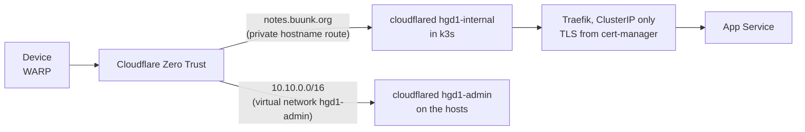

# Plan

Where this repo is going, so I can pick it up from here. Steps 1–6 (Flux and
sops, metrics-server and local-path, the public tunnel, Postgres, monitoring,
Keycloak) run on the cluster since 2026-11-24.

## Goal

Public applications on the hgd1 k3s cluster, deployed by pushing to Git.
The first one is **Cloudreve** (files in S3, login through Keycloak). An app
only brings its own manifests; this repo provides what every app needs:
GitOps, secrets, public access, Postgres, login and monitoring.

## What runs where

The rule: what has to exist before Kubernetes works, or must keep working
when it's broken, comes from Nix; what runs as pods comes from here.

| From `nix-hgd1-cluster` (Nix) | From this repo (Flux) | From app repos (Flux) |
| --- | --- | --- |
| Hosts, network, Ceph, the S3 endpoint, host monitoring, `clusterd`/`labctl`, the VMs, k3s with flannel and **CoreDNS** (Flux needs DNS to start) | Flux, sops, metrics-server, local-path, `cloudflared`, CloudNativePG, k3s monitoring, Keycloak | Cloudreve, `lab-console`, later apps |

## What the cluster already gives this repo

From `nix-hgd1-cluster`: k3s 1.35, three servers + two agents with zone
labels (`topology.kubernetes.io/zone` = host), API at
`https://k8s.lan.buunk.org:6443` (over WARP), the S3 endpoint
`https://s3.lan.buunk.org` (S3 users and buckets through `labctl s3`), and
monitoring stores at `mon.lan.buunk.org`. Pods reach the internet and
`*.lan.buunk.org`. Traefik and ServiceLB are disabled in k3s on purpose.

## Layout

```
clusters/hgd1/          # entry point: Flux itself and three Kustomizations
  flux-system/          #   written by flux bootstrap
  infrastructure.yaml   #   → ./infrastructure (controllers, operators)
  config.yaml           #   → ./config, dependsOn infrastructure
  platform.yaml         #   → ./platform (shared services: Keycloak), dependsOn config
  keycloak-realm.yaml   #   → ./platform/keycloak-realm, dependsOn platform
  apps.yaml             #   → ./apps, dependsOn platform
infrastructure/         # controllers, one folder each (HelmRepository + HelmRelease)
  metrics-server/  local-path/  cloudflared/  cert-manager/  cloudnative-pg/  monitoring/
components/             # reusable pieces for apps, e.g. postgres (defaults and backups)
config/                 # what needs their CRDs: Postgres template, tunnel routes
apps/                   # one file per app, pointing Flux at the app's repo
.sops.yaml              # which files are encrypted, for which age key
```

Secrets are encrypted with sops and age before they're committed; the
cluster holds the age private key, put there once by hand.

## Steps

Each step ends with something to check.

### 1. Flux and secrets

- [x] An age key for the cluster; its public key in `.sops.yaml`, the private
      key as a Secret in `flux-system` (once, by hand).
- [x] `flux bootstrap github --owner jurrebuunk --repository hgd1-k8s --path clusters/hgd1`.
- [x] Done when: `flux check` passes and a sops-encrypted test secret shows up
      decrypted in the cluster.

### 2. Take over the k3s add-ons

- [x] metrics-server and local-path-provisioner from here, with the same
      StorageClass name `local-path` and the same data path on each node.
- [x] Then in `nix-hgd1-cluster`: `metrics-server` and `local-storage` in the
      k3s `disable` list, deploy, `labctl vm roll`.
- [x] Done when: `kubectl top nodes` works and a test volume on `local-path`
      binds, both from Flux.

### 3. Public access: Cloudflare Tunnel

- [x] A tunnel `hgd1-apps` (`464b884a-410d-4066-8946-0532c41f1978`,
      separate from `hgd1-admin`, the hosts' WARP tunnel); its credentials
      sops-encrypted in `infrastructure/cloudflared/`.
- [x] `cloudflared` with three replicas, one per zone, at most one down at a
      time.
- [x] Its routes ("hostname → Service") in Git
      (`infrastructure/cloudflared/config.yaml`); a change rolls cloudflared.
- [x] DNS: one proxied CNAME per hostname → `<tunnel id>.cfargotunnel.com`.
      A wildcard `*.buunk.org` isn't possible (it has MX records). Made by
      hand for now; external-dns is
      [#1](https://github.com/jurrebuunk/hgd1-k8s/issues/1).
- [x] Cloudflare terminates TLS: no cert-manager, load balancer IPs or
      ingress controller for public apps.
- [x] Done when: `https://test.buunk.org` answers from the internet and
      stays up while one node is drained. Tested 2026-11-24: 247 of 247
      requests succeeded while `hgd1-k8m01` was drained and restarted.

**Publishing an app:** a route in `infrastructure/cloudflared/config.yaml`
(`hostname: x.buunk.org`, `service: http://<svc>.<ns>.svc.cluster.local:<port>`)
and its CNAME.

### 4. Postgres: CloudNativePG

Every app that needs Postgres gets **its own small cluster** (a primary plus
copies) in its own namespace, as CloudNativePG recommends; there is no shared
database server.

- [x] cert-manager (for the backup plugin's TLS), the CloudNativePG operator
      (1.30.1) and its Barman Cloud plugin, from Flux.
- [x] Backups to the bucket `pg-backups` (user and bucket made with
      `labctl s3`; the key sops-encrypted in `components/postgres/`), one
      folder per cluster:

    | Setting | Value | Why |
    | --- | --- | --- |
    | WAL upload (`archive_timeout`) | 5 min | At most that much lost; an idle database uploads nothing |
    | Compression | zstd | Less written to S3 |
    | Full copy | weekly (Sunday 03:00), and one at creation | The continuous WAL covers the days between |
    | Retention | 14 days | Old backups are deleted automatically |

- [x] `components/postgres`: an app's `Cluster` (name, instances, size,
      bootstrap) gets the rest from it: servers in different zones on
      `local-path`, the backups above, metrics scraping, modest resources.
      CloudNativePG makes the database, the user and the Secret
      `<cluster>-app` (with `uri`, `host`, `username`, `password`, …).
- [x] Done when: a test database survives deleting its primary, and a new
      cluster restores from the S3 backup. Tested 2026-11-24: the copy took
      over in 7 s with all rows; a cluster restored only from S3 had every
      row, including one written just before. The test and its backups are
      removed.
- [x] Wear: the S3 side is cheap (Ceph's HDDs spin all the time anyway);
      Postgres itself writes to the NVMe of the hosts it runs on. Watch
      `labctl disk list` (WEAR) once databases run.

**An app's database** (in the app's folder, with `components: [../../components/postgres]`
in its `kustomization.yaml`):

```yaml
apiVersion: postgresql.cnpg.io/v1
kind: Cluster
metadata: { name: notes-db }
spec:
  instances: 2           # 3 for apps everyone depends on (Keycloak)
  storage: { size: 2Gi }
  bootstrap: { initdb: { database: notes, owner: notes } }
```

The app reads `notes-db-app` (key `uri`) and connects to `notes-db-rw`. A
Helm chart's own built-in Postgres is never used: turn it off and point the
chart at the Cluster.

### 5. Monitoring inside k3s

- [x] vmagent (kubelets, cAdvisor, pods and services with
      `prometheus.io/scrape`) and kube-state-metrics, written to all three
      hosts' VictoriaMetrics with `cluster=hgd1-k8s`.
- [x] Vector on every node: pod logs to the hosts' VictoriaLogs, `host` =
      node, `unit` = container, plus `namespace` and `pod`.
- [x] Both go over the storage network to each host's storage IP, like the
      VMs' own logs; no router rule (the hosts accept 8428 and 9428 on
      `br-stor`, `nix-hgd1-cluster`).
- [x] Done when: `labctl logs --unit cloudflared` shows the tunnel's lines and
      `labctl metrics query 'kube_pod_info{cluster="hgd1-k8s"}'` the pods.
      Tested 2026-11-24, every target up.
- [ ] Pods reach more than they need on the storage network:
      [#2](https://github.com/jurrebuunk/hgd1-k8s/issues/2).

### 6. Keycloak

- [x] The official operator (26.8.2) from Keycloak's release manifests;
      Keycloak in a `platform` layer (after `config`, before `apps`).
- [x] Keycloak with 2 pods on different hosts, on its own Postgres with 3
      servers (`keycloak-db`, backed up like every cluster).
- [x] Public at `https://auth.buunk.org` through the tunnel; Cloudflare
      terminates TLS. The admin console and the `master` realm are **not
      public** (the tunnel answers 404); use
      `kubectl -n keycloak port-forward svc/keycloak-service 8080` and
      `http://localhost:8080/admin/` (port 8080 exactly). The `master`
      realm's address is `http://localhost:8080` (`platform/keycloak-realm/master.yaml`),
      so the admin console's login goes through the port-forward too.
- [x] The realm `hgd1` from Git (`platform/keycloak-realm/hgd1.yaml`, applied
      by keycloak-config-cli on every change): settings, brute-force
      protection, password policy, groups `admins`, `family`, `friends`.
- [x] **No people in Git.** Accounts and group membership are made in the
      admin console. The first login is `temp-admin`, generated into a sops
      Secret: read it with
      `kubectl -n keycloak get secret keycloak-bootstrap-admin -o jsonpath='{.data.password}' | base64 -d`,
      make your own admin in the `master` realm, then delete `temp-admin`.
      keycloak-config-cli uses its own generated machine login.
- [x] Done when: logins at `auth.buunk.org` work from the internet and stay
      up while a node restarts, and the database restores from S3. Tested
      2026-11-24: 288 of 288 requests answered while `hgd1-k8m02` (a
      Keycloak pod and a database server) restarted; a restore had both
      realms and the 3 groups.
- [x] Login theme **flatwork** (`platform/keycloak/theme/`): the
      flatwork-saas design language (Geist and IBM Plex Mono served by
      Keycloak, the muted palette with one blue accent, dark by default and
      light from the system). Own layout and sign-in form on top of the base
      theme; every other page through class mappings. The realm shows as
      "buunk".
- [ ] Mail for password resets: [#3](https://github.com/jurrebuunk/hgd1-k8s/issues/3).

**What lives where:** realm settings, clients, roles and which group gets
which role are code (reviewed, in the app's commit); who is in which group
is managed in the admin console.

### 7. Cloudreve, the first public app

Lives in its own repo, [hgd1-cloudreve](https://github.com/jurrebuunk/hgd1-cloudreve);
`apps/cloudreve.yaml` points Flux at it. Apps never go in this repo.

- [x] Cloudreve at `cloudreve.buunk.org` through the tunnel.
- [x] Database `cloudreve-db` from `components/postgres`.
- [x] Files in the bucket `cloudreve` (512 GB quota), S3 user `cloudreve`,
      key sops-encrypted in the app repo.
- [x] Browsers upload and download straight to the bucket through
      `files-s3.buunk.org`: a gateway that passes only `/cloudreve` and
      fixes the Content-Type Ceph rejects. 25 MB chunks (Cloudflare's
      100 MB request limit). CORS set by Cloudreve for its origin.
- [x] Login through Keycloak: Pro-only upstream, so hgd1-cloudreve builds
      its own image with an OIDC patch (`image/`). Client `cloudreve` here,
      roles `cloudreve-admin`/`cloudreve-user` per group. Registration
      stays off; a local admin keeps a password.
- [ ] Mail (password resets): [#4](https://github.com/jurrebuunk/hgd1-k8s/issues/4).
- [ ] Done when: from outside the network I log in, upload a file over
      100 MB, download it, and see it in `labctl s3 bucket show cloudreve`.

### 8. More apps

- [ ] `lab-console` behind Keycloak, and whatever comes next: each app repo
      brings its manifests, `apps/` points Flux at it, images from GHCR roll
      out through Flux's image automation.

### 9. Intranet, the people hub

My own app, in its own repo, behind Keycloak: a hub for people. Everyone
sees their profile and the apps they can use, a bit like Keycloak's account
console but ours, and each person can make their own corner of it. Keycloak
stays where accounts and passwords live.

**Layout:** the intranet is one page plus settings, with a sidebar.

```text
┌──────────────┬──────────────────────────────────────────┐
│ Home         │  Home: every app I have access to        │
│ ──────────── │  ┌───────────┐ ┌──────┐ ┌─────────────┐  │
│ My pages     │  │ Cloudreve │ │ …    │ │ lab-console │  │
│  Job issues  │  └───────────┘ └──────┘ │ needs WARP  │  │
│  …           │                         └─────────────┘  │
│ + New page   │                                          │
│ ──────────── │                                          │
│ Settings     │                                          │
└──────────────┴──────────────────────────────────────────┘
```

| Part | What | Who |
| --- | --- | --- |
| **Home** | Every app the person has access to, like the applications list in Keycloak's account console. Apps behind WARP (step 10) show as *not available, connect WARP* until the person is on WARP; then they show like the rest. Nothing personal here | Shared, defined by me |
| **My pages** (sidebar) | Pages a person made; **+ New page** creates one and embeds a site or tool in it | Personal, only theirs |
| **Settings** | Profile and picture, their browser start page, their quick links | Personal |

The **browser start page** is something else than Home: a separate, light
page a person sets as their browser's home or new-tab page, configured in
Settings. Personal things never show up on Home or for other people, so the
intranet itself stays clean.

- [ ] Intranet app: sign in through Keycloak; Home with the apps the
      person has a role for, read from Keycloak (the same clients its
      account console lists).
- [ ] WARP-aware Home: for each app behind WARP, the browser tries the
      app's private hostname (a small request with a short timeout). It
      works only when the person is on WARP *and* Gateway lets them in, so
      it shows exactly what they can use. Not available: greyed out with a
      link to how to set up WARP.
- [ ] **Browser start page:** a DuckDuckGo search bar (a plain form to
      `https://duckduckgo.com/`, no tracking of searches on our side), their
      apps and their own quick links, arranged in Settings. It has to load
      fast and keep them signed in for a long time, since it opens with
      every browser window.
- [ ] **My pages and + New page:** a person makes pages for their own needs
      and embeds a site or small tool in each, for example an issue tracker
      for my job. Embedded content runs in a sandboxed iframe (`sandbox`,
      its own origin) so it can't touch the intranet's session. Many sites
      refuse to be framed (`X-Frame-Options`, CSP `frame-ancestors`); those
      become a link card instead.
- [ ] Profile picture upload: the image in its own S3 bucket, served at a
      public URL; the intranet writes that URL into the Keycloak user's
      `picture` attribute (through its own service client).
- [ ] Realm: user-profile attribute `picture`, `https://` only, set by the
      intranet and read-only for people in the account console. Clients
      that request `profile` get it as the `picture` claim.
- [ ] Then Cloudreve shows it as the avatar: a patch that takes the
      `picture` claim at sign-in and redirects to it, without downloading
      it ([hgd1-cloudreve#2](https://github.com/jurrebuunk/hgd1-cloudreve/issues/2)).
      Also fixes Cloudreve's own uploaded avatars being lost on restart.

### 10. Internal apps over WARP

Apps that shouldn't be public, reachable from anywhere over WARP, for me and
later for family. Not through a local ingress on VLAN 40: the VLANs are
strict, and this needs no router rule, VLAN change or load balancer IP.



- **A second tunnel in the cluster, `hgd1-internal`.** `cloudflared` runs
  in k3s like `hgd1-apps` and reaches apps over the cluster network. It
  sits next to `hgd1-admin`: WARP is one connection, and Cloudflare picks
  the tunnel by destination.
- **Names under `buunk.org`, like the public apps:** one
  [private hostname route](https://developers.cloudflare.com/cloudflare-one/networks/connectors/cloudflare-tunnel/private-net/cloudflared/connect-private-hostname)
  per app (`notes.buunk.org` → `hgd1-internal`), no public DNS record, so
  the name only exists for people on WARP. **Never a route for
  `*.buunk.org`**: it would take over the public apps and the older
  hostnames (drive, crm, …) for everyone on WARP. Making an app public
  later: delete its route, add its proxied CNAME.
- **HTTPS from the cluster:** a private route passes through to the
  origin, so Cloudflare doesn't do TLS. An internal Traefik (ClusterIP
  only, no MetalLB) ends TLS with Let's Encrypt certificates from
  cert-manager over DNS-01 on `buunk.org` (a sops Cloudflare token with DNS
  edit; the same kind external-dns needs, #1). Certificates show up in the
  public certificate logs, so the app names are visible there (not
  reachable); `<app>.int.buunk.org` with one wildcard would hide them.
- **Admin only when I need it:** move the route `10.10.0.0/16` of
  `hgd1-admin` into its own
  [virtual network](https://developers.cloudflare.com/cloudflare-one/connections/connect-networks/private-net/cloudflared/tunnel-virtual-networks)
  `hgd1-admin`; day to day the WARP client is on the default network
  (apps), and I switch to `hgd1-admin` for managing. The Gateway rule
  "only my email may reach `10.10.0.0/16`" stays.

**Part 1, internal access for me** (running):

- [x] Test first: hostname routes work on every virtual network, so apps
      stay reachable while on `hgd1-admin`.
- [x] The account's initial resolved range is already `172.64.128.0/20`
      (fine for Chrome, no Split Tunnel entry needed).
- [x] Tunnel `hgd1-internal`: `infrastructure/cloudflared-internal/`, two
      replicas in two zones, `warp-routing` on.
- [x] Internal Traefik (`infrastructure/traefik-internal/`, ClusterIP,
      class `internal`, HTTP → HTTPS, HSTS) and `coredns-custom` with one
      line per app.
- [x] Gateway: allow me through tunnels, default deny for everyone else
      (rule on *traffic destination: tunnel*; a rule on the 172.64 range
      never matches).
- [x] Virtual network `hgd1-admin` holds `10.10.0.0/16`; WARP stays on
      `default` all day.
- [x] Test app `whoami.buunk.org` reachable over WARP, blocked without the
      allow rule.
- [x] Let's Encrypt over DNS-01, one certificate per app: whoami has a
      trusted certificate (staging first, then production). The token is
      the S3 endpoint's DNS token for now.
- [x] Docs: [Internal access](https://jurrebuunk.github.io/hgd1-k8s/concepts/internal-access/),
      [Publish an internal app](https://jurrebuunk.github.io/hgd1-k8s/how-to/publish-an-internal-app/).

**Part 2, for others:**

- [x] WARP enrolment through Keycloak: client `cloudflare-zero-trust`, role
      `warp` for `admins` and `family`; Cloudflare's login method
      "buunk (Keycloak)" with the claims `roles` and `groups`. My own
      enrolment needs the one-time PIN, and the Keycloak policy excludes my
      email, so a Keycloak account can't pass as me or reach the admin
      network. Free plan: up to 50 users.
- [x] Gateway rules per app and group: the pattern (SNI hostname and
      `groups=<group>` claim) is checked; added per app when it's published.
- [ ] Try it with a real family account (sign in to WARP, see the
      default deny until an app allows them).
- [ ] First real internal app: `lab-console` at `lab.buunk.org`; then
      remove `whoami`.

## Needed from other repos

| Step | Where | What |
| --- | --- | --- |
| 2 | `nix-hgd1-cluster` | `metrics-server` and `local-storage` disabled in k3s |
| 3 | Cloudflare | The tunnel `hgd1-apps` (done) and a DNS token for external-dns (#1) |
| 4, 7 | `labctl` | S3 users and buckets (needs the RGW cap for `clusterd`) |
| 5 | `nix-hgd1-cluster` | The hosts accept 8428 and 9428 on the storage bridge (done; no router rule needed) |
| 10 | `nix-hgd1-cluster` | Remote access docs: admin route in virtual network `hgd1-admin`, WARP on all day; addresses page: `lab.buunk.org` over WARP and no MetalLB range |

## Later

- Forgejo, public and mirrored to GitHub.

## Not planned

- **ceph-csi:** apps keep their state in Postgres on `local-path` or in S3,
  so there is no Ceph block storage for pods.
