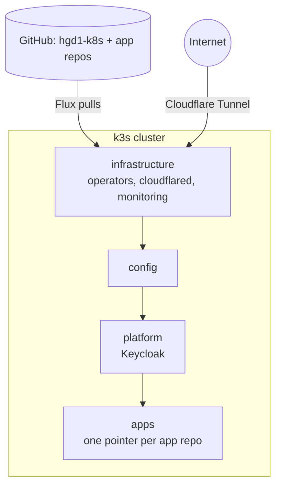

# Concepts

How the Kubernetes side works and why. Read [GitOps](gitops.md) first; the
other pages assume it.

## Layers

1. **GitOps.** Flux applies this repo and the app repos in layers. See
   [GitOps](gitops.md).
2. **Public access.** A Cloudflare Tunnel in the cluster; a route and a DNS
   record publish an app. See [Public access](public-access.md).
3. **Postgres.** One small CloudNativePG cluster per app, backed up to S3.
   See [Postgres](postgres.md).
4. **Logins.** Keycloak at `auth.buunk.org`. See [Keycloak](keycloak.md).
5. **Monitoring.** Pod logs and metrics into the hosts' stores. See
   [Monitoring](monitoring.md).

## Decisions

??? note "Flux, pulling from GitHub"

    Nothing outside the cluster needs credentials for it: Flux pulls, CI
    only builds images. A change is a commit and a rollback a revert.

??? note "One repo per app"

    An app's manifests, secrets and database live with the app, so it can be
    added or removed without touching the platform beyond one pointer file,
    a route and a Keycloak client.

??? note "A Postgres cluster per app, not one shared server"

    Load, upgrades and restores of one app never touch another; removing an
    app removes its database cleanly. Each costs a few hundred MB.

??? note "Public through a tunnel, no ingress controller"

    Cloudflare terminates TLS; no port is opened on the network and no
    certificate or load balancer IP is needed. LAN-only ingress comes later.

??? note "No Ceph block storage for pods"

    State goes to Postgres on `local-path` (replicating itself) or to S3,
    never to a single disk, so there's no ceph-csi.

## Concept pages

- :lucide-git-branch: [**GitOps**](gitops.md): Flux, layers, one repo per app
- :lucide-globe: [**Public access**](public-access.md): the Cloudflare Tunnel
- :lucide-database: [**Postgres**](postgres.md): CloudNativePG and backups
- :lucide-key-round: [**Keycloak**](keycloak.md): logins for apps
- :lucide-activity: [**Monitoring**](monitoring.md): pod logs and metrics
- :lucide-layout-dashboard: [**Web UI**](web-ui.md): the browser dashboard

