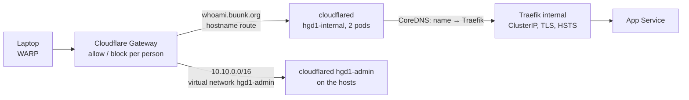

# Internal access

Apps that aren't public, reachable from anywhere over WARP, under normal
`buunk.org` names with HTTPS. A second Cloudflare Tunnel in the cluster
carries them; Cloudflare only sends traffic there from WARP clients that a
Gateway rule lets through. No VLAN, router rule or load balancer address is
involved, so the strict VLANs stay as they are.

!!! info "At a glance"

    **Status** <span class="status">Running</span> (certificates wait
    for a DNS token) · **Sign-in** one-time PIN (me) or Keycloak (`warp` role) · **Tunnel** `hgd1-internal`
    (`46adc72d-f011-4a1d-b7fd-b4c22f3a8447`) · **Ingress class** `internal`
    · **How-to** [Publish an internal app](../how-to/publish-an-internal-app.md)
    · **Roadmap** [step 10](../reference/roadmap.md#10-internal-apps-over-warp)

## Overview



## How it works

### Names

Each internal app has a **hostname route** in Cloudflare
(`whoami.buunk.org` → tunnel `hgd1-internal`) and **no public DNS record**.
On WARP, Cloudflare answers the name with an address from its own range
(`172.64.128.0/20`) and sends the connection to the tunnel; everywhere else
the name doesn't exist. Public and internal apps share `buunk.org`; there
is never a route for `*.buunk.org`, which would take the public apps and
the older hostnames for everyone on WARP. A hostname route also matches its
subdomains (`x.whoami.buunk.org`).

Inside the cluster `cloudflared` looks the name up again: CoreDNS
(`infrastructure/coredns/coredns-custom.yaml`) rewrites each internal name to
the internal Traefik's Service, so one line per app.

### HTTPS

A hostname route passes the connection through unchanged, so the cluster
does TLS, not Cloudflare. The internal Traefik (`infrastructure/traefik-internal/`,
ClusterIP only) serves the app's certificate, redirects HTTP to HTTPS and
adds HSTS for a year. Certificates are Let's Encrypt, one per app, from
cert-manager over DNS-01 on Cloudflare (`config/cert-manager/`); not a
wildcard, because `_acme-challenge.buunk.org` already points at acme-dns for
something else. Every certificate appears in public certificate logs, so the
app names are visible there, not reachable.

### Who gets in

Gateway network rules, in order (Zero Trust → Traffic policies → Network):

| # | Rule | Traffic | Who |
| --- | --- | --- | --- |
| 500 | Block | Storage `10.10.30.0/24` | everyone |
| 1000 | Allow | `10.10.0.0/16` | me |
| 1100 | Allow | Everything leaving through a tunnel | me |
| 2000 | Block | `10.10.0.0/16` | everyone else |
| 2100 | Block | Everything leaving through a tunnel | everyone else |

Rule 2100 is the default deny for internal apps. An app for others gets an
allow rule above it per app and group, on the hostname and the Keycloak
group:

```text
traffic:  net.sni.host == "notes.buunk.org"
identity: any(identity.oidc_claims[*] == "groups=family")
```

Rule 2100 It matches on *Traffic
destination: Cloudflare Tunnel* (`net.offramp.type`), not on the
`172.64.128.0/20` addresses: Gateway evaluates network rules after it has
mapped those back, so a rule on them never matches. The tunnel selector
also covers plain HTTP. Rules for other people per app use the hostname
(`net.sni.host`, HTTPS only).

### Signing in to WARP

Devices enrol at `https://buunk.cloudflareaccess.com/warp` (team `buunk`),
with two login methods:

| Login method | Policy on the WARP enrolment app | For |
| --- | --- | --- |
| One-time PIN | *Allow Jurre (one-time PIN only)*: my email, and the login must be the PIN | Me, and so the admin network: it doesn't depend on Keycloak or k3s |
| buunk (Keycloak) | *Allow buunk accounts with role warp*: claim `roles` contains `warp`, login through Keycloak, my email excluded | `admins` and `family` (Keycloak client `cloudflare-zero-trust`) |

Why the PIN and the exclusion: Gateway's admin rules go by email, and people
can change their own email in Keycloak. Without them, a Keycloak account set
to my email would enrol as me and reach `10.10.0.0/16`.

Gateway sees the claims `roles` and `groups` of the Keycloak login
(`identity.oidc_claims`). A group change counts after the person signs in
to WARP again (Re-authenticate in the client). Someone enrolled through
Keycloak reaches nothing internal until an app's allow rule names their
group (rule 2100), and never the site (rule 2000).

To let someone in: put them in `family` in Keycloak; they install the
Cloudflare One client, enter team `buunk`, and choose **buunk (Keycloak)**.
To remove them: take them out of the group and revoke their device in Zero
Trust → Devices.

### Admin only when needed

The site route `10.10.0.0/16` (tunnel `hgd1-admin`) is in its own virtual
network, `hgd1-admin`. The WARP client stays connected all day on
`default`; switch to manage the site:

| | `default` | `hgd1-admin` |
| --- | --- | --- |
| Internal apps | ✓ | ✓ |
| Public apps | ✓ | ✓ |
| SSH, `*.lan.buunk.org`, kubectl, labctl | – | ✓ |

Hostname routes don't belong to a virtual network, so internal apps work
on both. Switching drops open connections through WARP.

```sh
warp-cli vnet                                         # list, and which is selected
warp-cli vnet 84c40b26-4fac-4131-a48a-9db3ca63267c    # hgd1-admin
warp-cli vnet 21a5b1d6-194b-4826-963d-d3352e64dfe5    # default
```

## Configuration

| Piece | Where |
| --- | --- |
| Tunnel, `warp-routing` | `infrastructure/cloudflared-internal/` (credentials sops) |
| Internal Traefik | `infrastructure/traefik-internal/release.yaml` (chart 42.4.0) |
| Name → Traefik | `infrastructure/coredns/coredns-custom.yaml` |
| Certificate issuers | `config/cert-manager/clusterissuers.yaml`, token `cloudflare-dns-token` |
| Hostname routes, Gateway rules, virtual networks | Zero Trust dashboard (or the API) |
| Test app | `platform/whoami/` → `https://whoami.buunk.org` |

## Troubleshooting

| You see | Likely cause and fix |
| --- | --- |
| Name doesn't resolve | WARP off, or no hostname route for it; `getent hosts <name>` should give `172.64.x.x` |
| Connection refused or times out | Gateway blocks it (rule 2100, check your allow rule), or `cloudflared` in `cloudflared-internal` is down |
| 404 from Traefik | No Ingress with `ingressClassName: internal` for that host, or the CoreDNS line is missing |
| Certificate warning | The certificate isn't issued yet (`kubectl -n <ns> get certificate`), or it's still the staging issuer |
| SSH or `lan.buunk.org` doesn't work | You're on `default`; switch to `hgd1-admin` |
