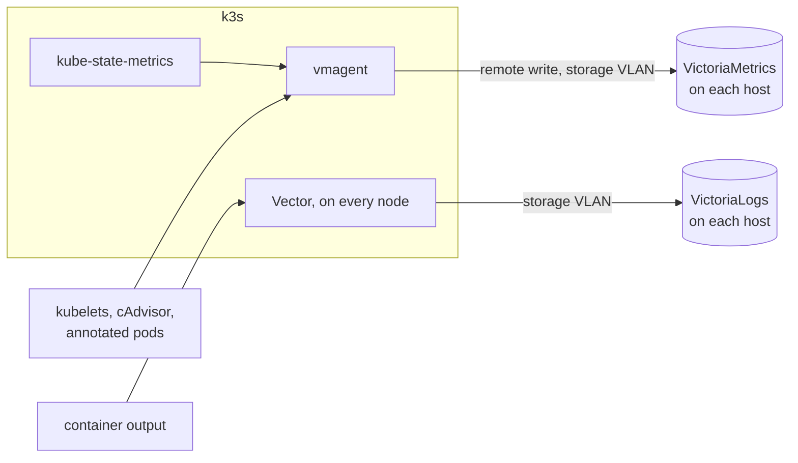

# Monitoring

Logs and metrics from the cluster go into the **same stores as the hosts'**
(VictoriaMetrics and VictoriaLogs on the three hypervisors), so one query
covers both. This repo only runs the collectors; the stores, their
retention and the query address are on the cluster docs.

!!! cluster "On the cluster docs: monitoring"

    Where the data is stored, retention, `mon.lan.buunk.org`, and
    `labctl metrics` / `labctl logs`.

    [Monitoring](https://jurrebuunk.github.io/nix-hgd1-cluster/concepts/monitoring/){ .md-button }

!!! info "At a glance"

    **Status** <span class="status">Done</span> · **Folder**
    `infrastructure/monitoring/` · **Label** `cluster="hgd1-k8s"` on every
    metric · **Writes to** `10.10.30.11–13`, ports 8428 and 9428

## Overview



| Collector | Collects | Writes |
| --- | --- | --- |
| vmagent | Kubelets, cAdvisor, pods and services annotated with `prometheus.io/scrape` | All three hosts' VictoriaMetrics, `cluster="hgd1-k8s"` |
| kube-state-metrics | Object state: pods, deployments, nodes | Scraped by vmagent in its own job (`honor_labels`, so its `namespace` and `pod` labels stay) |
| Vector (DaemonSet) | Every container's output, from the node's pod log folder | All three hosts' VictoriaLogs; `host` = node, `unit` = container, plus `namespace` and `pod` |

Both write to each host's storage IP over the storage VLAN, the way the
VMs ship their own logs: no router rule, and a host that is down catches up
from the collectors' buffers.

## An app's metrics and logs

- **Logs:** nothing to do. `labctl logs --unit <container> --since 1h`, or
  `labctl logs 'namespace:notes'`.
- **Metrics:** annotate the pod with `prometheus.io/scrape: "true"` and
  `prometheus.io/port: "<port>"` (and `prometheus.io/path` if it isn't
  `/metrics`). Postgres clusters are scraped automatically.

```sh
labctl metrics query 'kube_pod_info{cluster="hgd1-k8s", namespace="notes"}'
labctl logs --since 1h 'namespace:keycloak'
```

A Grafana in the cluster would use a host's storage IP
(`http://10.10.30.11:8428`, `:9428`; also `.12` and `.13`): the query VIP
`mon.lan.buunk.org` is on the infra VLAN, which k3s can't reach.

## Troubleshooting

| You see | Likely cause |
| --- | --- |
| No logs from a pod | Vector on that node: `kubectl -n monitoring get pods -o wide`, then its logs |
| A metric without `namespace`/`pod` | It came through a job without `honor_labels`; kube-state-metrics needs its own job |
| Nothing from the cluster at all | The hosts must accept 8428 and 9428 on `br-stor` (`nix-hgd1-cluster`, `modules/monitoring/firewall.nix`) |

## Related

- Pods can reach more than they need on the storage network:
  [#2](https://github.com/jurrebuunk/hgd1-k8s/issues/2).
