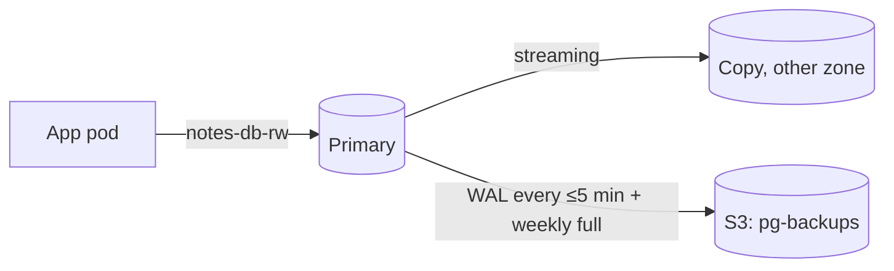

# Postgres

Every app that needs Postgres gets **its own small cluster** (a primary plus
copies) in its own namespace, run by the CloudNativePG operator. There is no
shared database server: an app's database lives and dies with the app.

!!! info "At a glance"

    **Status** <span class="status">Done</span> · **Operator** CloudNativePG
    1.30.1 with the Barman Cloud plugin · **Defaults** `components/postgres`
    · **Backups** `s3://pg-backups/<cluster>/`, 14 days

## Overview



- **Servers on `local-path`**, the NVMe of the node they run on, in
  different zones (hosts). They replicate to each other, so losing a host
  loses one copy, not the data.
- **Failover is automatic:** if the primary's host dies, a copy takes over
  within seconds; `<cluster>-rw` always points at the primary.
- **Backups go to Ceph through S3**, so a cluster can be rebuilt from S3
  alone.

Why not one shared Postgres: one app's load, upgrade or restore never
touches another's, and removing an app removes its database cleanly. A
cluster with 2 servers costs little (a few hundred MB of memory).

## An app's database

In the app repo's `deploy/`:

```yaml
# kustomization.yaml
components: [../components/postgres]
---
apiVersion: postgresql.cnpg.io/v1
kind: Cluster
metadata: { name: notes-db }
spec:
  instances: 2           # 1: no copy (S3 only); 3: apps everyone needs (Keycloak)
  storage: { size: 2Gi }
  bootstrap: { initdb: { database: notes, owner: notes } }
```

CloudNativePG creates the database, the user and the Secret `notes-db-app`
(`uri`, `host`, `port`, `dbname`, `username`, `password`). The app connects
to `notes-db-rw`:

```yaml
env:
  - name: DATABASE_URL
    valueFrom: { secretKeyRef: { name: notes-db-app, key: uri } }
```

**Helm charts:** never use a chart's built-in Postgres
(`postgresql.enabled`): a single server without failover or backups. Turn it
off and point the chart's external-database settings at the Cluster and its
Secret.

## What `components/postgres` adds

| Setting | Value | Why |
| --- | --- | --- |
| Placement | Servers in different zones, on `local-path` | A host loss takes one copy |
| WAL upload (`archive_timeout`) | 5 min | At most that much lost; an idle database uploads nothing |
| Compression | zstd | Less written to S3 |
| Full copy | Weekly (Sunday 03:00) and one at creation | The continuous WAL covers the days between |
| Retention | 14 days | Old backups are deleted automatically |
| Metrics | Scrape annotations | Shows up in [Monitoring](monitoring.md) |
| Resources | Modest requests and limits | A node has 4 GiB of RAM |

The backup key (S3 user `pg-backups`, made with `labctl s3`) is
`components/postgres/backup-s3.sops.yaml`.

## Operating

```sh
kubectl get clusters.postgresql.cnpg.io -A           # every database, its primary, Ready?
kubectl -n <ns> get backups                          # backups of a cluster
labctl s3 bucket show pg-backups                     # what's in the bucket
```

**Restore** into a new cluster from the backup (same namespace, new name):

```yaml
spec:
  bootstrap:
    recovery: { source: notes-db }
  externalClusters:
    - name: notes-db
      plugin:
        name: barman-cloud.cloudnative-pg.io
        parameters: { barmanObjectName: pg-backups, serverName: notes-db }
```

Then point the app at the new cluster's Secret, or rename back once it's
done.

**Removing an app** removes its database; its backups stay in S3 for 14
days. To recreate a database from scratch (for example after a password
leaked), suspend the app's Flux Kustomization, delete the Cluster and its
ScheduledBackup, delete `s3://pg-backups/<cluster>/`, and resume.

## Tested

- Deleting the primary: the copy took over in 7 seconds with every row.
- A cluster restored only from S3 had every row, including one written just
  before.

## Disks

The S3 side is cheap (Ceph's HDDs spin anyway); Postgres itself writes to
the NVMe of the hosts it runs on. Watch wear with `labctl disk list`.

!!! cluster "On the cluster docs: S3"

    The S3 endpoint the backups go to, users and buckets with `labctl s3`.

    [S3 endpoint](https://jurrebuunk.github.io/nix-hgd1-cluster/concepts/s3/){ .md-button }
