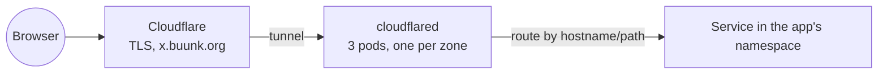

# Public access

Public apps reach the internet through a **Cloudflare Tunnel** that runs in
the cluster. `cloudflared` connects out to Cloudflare; Cloudflare terminates
TLS and sends requests through the tunnel to a Kubernetes Service. No port
on the network is opened, and there's no ingress controller or certificate
for public apps.

!!! cluster "On the cluster docs: remote access"

    The other tunnel, `hgd1-admin` on the hosts, which WARP uses for admin
    access to the network.

    [Remote access](https://jurrebuunk.github.io/nix-hgd1-cluster/concepts/remote-access/){ .md-button }

!!! info "At a glance"

    **Status** <span class="status">Done</span> · **Tunnel** `hgd1-apps`
    (`464b884a-410d-4066-8946-0532c41f1978`) · **Routes**
    `infrastructure/cloudflared/config.yaml` · **Current routes**
    [Routes and apps](../reference/routes.md) · **How-to** [Publish an app](../how-to/publish-an-app.md)

## Overview



## How it works

### Routes

`cloudflared` reads an ingress list: each entry matches a hostname (and
optionally a path regex) and names a Service. The last entry answers 404 for
everything else. A route with `service: http_status:404` blocks a path, as
for Keycloak's admin console. On `auth.buunk.org`, the exact root `/` goes to
a small redirect Service, which returns a fixed 302 to the hgd1 account console;
other allowed paths go straight to Keycloak. Deploy that Service in `platform`
before enabling the root route (see [Keycloak](keycloak.md#operating)).

### DNS

Every hostname needs a **proxied** CNAME in the `buunk.org` zone to
`<tunnel id>.cfargotunnel.com`. A wildcard `*.buunk.org` isn't possible (the
zone has MX records), so it's one record per hostname, made by hand for now
([external-dns: #1](https://github.com/jurrebuunk/hgd1-k8s/issues/1)).

### HTTPS only

Set on the whole `buunk.org` zone in Cloudflare (SSL/TLS → Edge
Certificates), so every new hostname gets it without a step:

| Setting | Value | Effect |
| --- | --- | --- |
| Always Use HTTPS | on | `http://` answers 301 to the same `https://` URL |
| HSTS | `max-age=31536000`, no `includeSubDomains`, no preload | Browsers that saw a hostname once only use HTTPS for it for a year |
| Minimum TLS version | 1.2 | TLS 1.0 and 1.1 are refused |
| SSL mode | Full (strict) | Unchanged |

These also apply to the zone's other proxied hostnames (`home`,
`tapset`), which serve HTTPS too. HSTS stays per hostname: with
`includeSubDomains` or preload, every name under `buunk.org` would have to
serve HTTPS forever.

### Limits

- **100 MB per request** on the free plan: apps that upload large files must
  upload in chunks (Cloudreve: 25 MB).
- **Bots:** Cloudflare may answer 403 to scripts with a default user agent;
  test with a browser user agent.

## Configuration

| File | Owns |
| --- | --- |
| `infrastructure/cloudflared/config.yaml` | The routes; generated into a ConfigMap with a hash, so a change rolls cloudflared |
| `infrastructure/cloudflared/deployment.yaml` | Three replicas, one per zone, at most one down |
| `infrastructure/cloudflared/credentials.sops.yaml` | The tunnel's credentials |

## Operating

```sh
kubectl -n cloudflared get pods -o wide        # three, on three hosts
labctl logs --unit cloudflared --since 30m     # connections and route errors
```

The tunnel's health is also in the Cloudflare dashboard: Zero Trust →
Networks → Tunnels → `hgd1-apps`.

## Troubleshooting

See [Troubleshooting → Public access](../operate/troubleshooting.md#public-access).

## Tested

247 of 247 requests succeeded while a node was drained and restarted.

## Related

- [Publish an app](../how-to/publish-an-app.md) · [Routes and apps](../reference/routes.md) · [Keycloak](keycloak.md)
