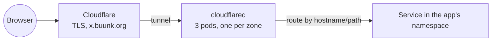

# Public access

Public apps reach the internet through a **Cloudflare Tunnel** that runs in
the cluster. `cloudflared` connects out to Cloudflare; Cloudflare terminates
TLS and sends requests through the tunnel to a Kubernetes Service. No port
on the network is opened, and there's no ingress controller or certificate
for public apps.

!!! info "At a glance"

    **Status** <span class="status">Done</span> · **Tunnel** `hgd1-apps`
    (`464b884a-410d-4066-8946-0532c41f1978`) · **Routes**
    `infrastructure/cloudflared/config.yaml` · **DNS** one proxied CNAME per
    hostname



This tunnel is separate from `hgd1-admin`, the tunnel on the hosts that
WARP uses for admin access to the network.

!!! cluster "On the cluster docs: remote access"

    The admin tunnel `hgd1-admin` and WARP, for reaching the LAN from the
    laptop.

    [Remote access](https://jurrebuunk.github.io/nix-hgd1-cluster/concepts/remote-access/){ .md-button }

## Publishing an app

Two steps, both needed:

1. **A route** in `infrastructure/cloudflared/config.yaml`, above the final
   `http_status:404`:

    ```yaml
    - hostname: notes.buunk.org
      service: http://notes.notes.svc.cluster.local:80
    ```

    A `path:` (regex) narrows a route; a route with `service: http_status:404`
    blocks a path, as for Keycloak's admin console. The config is generated
    into a ConfigMap with a hash, so a change rolls cloudflared by itself.

2. **A DNS record** in the `buunk.org` zone: a **proxied** CNAME
   `notes.buunk.org` → `464b884a-410d-4066-8946-0532c41f1978.cfargotunnel.com`.
   Made by hand (dashboard or API) for now;
   [external-dns](https://github.com/jurrebuunk/hgd1-k8s/issues/1) would make
   it from the routes. A wildcard `*.buunk.org` isn't possible: the zone has
   MX records.

Removing an app: delete its route and its DNS record.

## Current routes

| Hostname | To | Notes |
| --- | --- | --- |
| `auth.buunk.org` | Keycloak | `/admin` and `/realms/master` answer 404 |
| `cloudreve.buunk.org` | Cloudreve | |
| `files-s3.buunk.org` | Cloudreve's S3 gateway | Only `/cloudreve/…` (the bucket); everything else 404 |

## Limits

- **100 MB per request** on the free plan. Apps that upload large files must
  upload in chunks (Cloudreve: 25 MB).
- **No unsigned Content-Type on presigned S3 uploads** is a Ceph rule, not a
  tunnel one; see the gateway in
  [hgd1-cloudreve](https://github.com/jurrebuunk/hgd1-cloudreve#readme) if
  browsers upload straight to a bucket.
- Bots: Cloudflare may answer 403 to unusual clients (scripts with a default
  user agent). Test with a browser user agent.

## Availability

Three cloudflared pods, one per zone, at most one down at a time. Tested:
247 of 247 requests succeeded while a node was drained and restarted.

## Related

- [Build an app](../how-to/build-an-app.md#exposing) · [Keycloak](keycloak.md)
