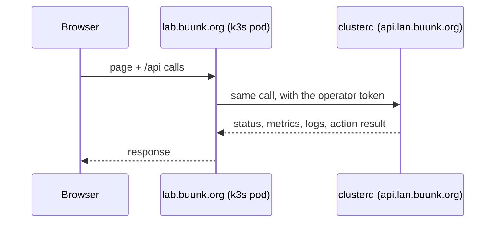

# Web UI

!!! repo "Lives in its own repo: lab-console"

    This page covers **the web UI (`lab-console`)** on the hgd1 cluster: how it fits in and how I
    use it here. Code, development, releases and the full documentation are in
    the repo.

    [:fontawesome-brands-github: jurrebuunk/lab-console](https://github.com/jurrebuunk/lab-console){ .md-button .md-button--primary }

**`lab-console`**, the browser dashboard at **`https://lab.buunk.org`**:
health of hosts, VMs, k3s and Ceph, metrics, logs and a few safe actions,
from any device. It talks to the platform only through the
[Platform API](https://jurrebuunk.github.io/nix-hgd1-cluster/concepts/api/), and it isn't tied to this one site.

!!! info "At a glance"

    **Status** In development ·
    **Runs on** k3s, deployed by Flux (pointer in `apps/`) · **Talks to**
    `clusterd` with an `operator` token

## Overview

- **Frontend and a thin proxy in one pod.** The pod serves the static
  frontend and forwards `/api` to `clusterd`. The browser never holds an API
  token, and `clusterd` never has to be public.
- **Scope `operator`:** everything a `read` token sees, plus the few actions I
  allow from anywhere. `manage` stays with the CLI over WARP.
- **A broken console never affects the platform.** It can be rebuilt or moved
  freely; the CLI keeps working without it.

## Access

| Stage | How you reach it |
| --- | --- |
| Now | Internal only: `lab.buunk.org` as a private hostname route over WARP, through the internal tunnel ([roadmap, step 10](../reference/roadmap.md#10-internal-apps-over-warp)) |
| Later | Public through the [tunnel](public-access.md), with login through [Keycloak](keycloak.md) (OIDC). It only goes public once Keycloak is in front of it |

## How it works

| Part | Detail |
| --- | --- |
| Frontend | A small single-page app; flatwork-ui colours (`#1b1818`, `#8aa1a8`) |
| Proxy | Caddy or nginx in the same pod, adds the token from a Kubernetes Secret |
| Token | An `operator` token, encrypted with sops ([Manage secrets](../how-to/manage-secrets.md)) |
| Network | One OPNsense rule: K8S → `10.10.20.20:443` (the API VIP), see the [network firewall](https://jurrebuunk.github.io/hgd1-network/reference/firewall/) |
| Data | `/v1/status`, `/v1/metrics/query_range`, `/v1/logs/query` |
| Actions | `/v1/actions/…`; every action shows what it will do and asks for confirmation |
| Delivery | CI builds `ghcr.io/jurrebuunk/lab-console`; Flux rolls out new images |
| API | `/v1/…` of the [Platform API](https://jurrebuunk.github.io/nix-hgd1-cluster/reference/api/) |

## Configuration

Code, image and Kubernetes manifests (`deploy/`) live in `lab-console`;
this repo has its pointer in `apps/`, like [every app](gitops.md#one-repo-per-app).

## Develop

Building, running locally and releasing the web UI happen in
[`lab-console`](https://github.com/jurrebuunk/lab-console).

## Troubleshooting

See [Troubleshooting](../operate/troubleshooting.md#web-ui) here, and
[Troubleshooting → API](https://jurrebuunk.github.io/nix-hgd1-cluster/operate/troubleshooting/#api) on the cluster docs.

## Related

- On the cluster docs: [Platform API](https://jurrebuunk.github.io/nix-hgd1-cluster/concepts/api/) · [Use the CLI](https://jurrebuunk.github.io/nix-hgd1-cluster/how-to/use-the-cli/)
