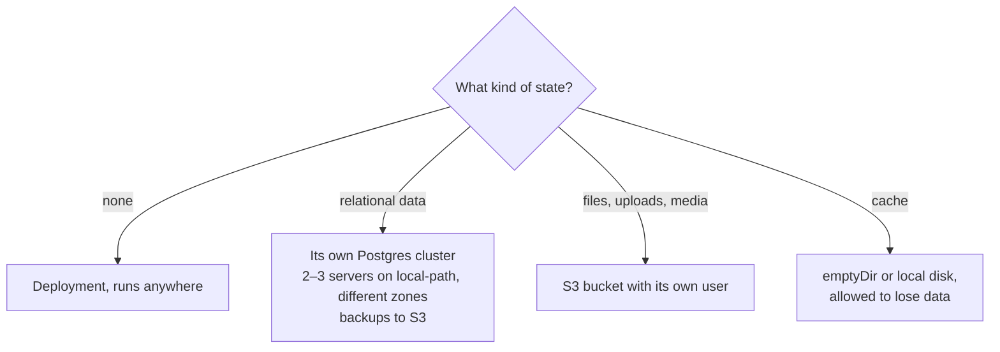

# Build an app

This page is for building something on the platform: a new app, a database,
a service that needs storage. You don't need to know NixOS for that: an app
gets a **Kubernetes API**, the **S3 endpoint**, and the shared services of
this repo (public access, Postgres, logins, monitoring).

## Platform

| You get | Details |
| --- | --- |
| Kubernetes API | `https://k8s.lan.buunk.org:6443`, k3s 1.35, five nodes (three schedulable servers, two agents) once finished |
| Zones | `topology.kubernetes.io/zone` = `hgd1-hv01`, `hgd1-hv02`, `hgd1-hv03`; one zone per physical host |
| Local disks | `local-path` StorageClass on each node's NVMe |
| Object storage | `https://s3.lan.buunk.org`, path-style, region `us-east-1` |
| Egress | Internet from pods (image registries, APIs) |
| Internal DNS | `*.lan.buunk.org` names resolve inside pods |

On top of that, from this repo: [public access](../concepts/public-access.md)
through a Cloudflare Tunnel, [Postgres](../concepts/postgres.md) with S3
backups, [logins](../concepts/keycloak.md) through Keycloak and
[monitoring](../concepts/monitoring.md) of pods, and
[internal access](../concepts/internal-access.md) over WARP for apps that
aren't public.

## Access

```sh
git clone https://github.com/jurrebuunk/nix-hgd1-cluster
cd nix-hgd1-cluster && nix develop
warp-cli connect
warp-cli vnet 84c40b26-4fac-4131-a48a-9db3ca63267c   # hgd1-admin: the site, kubectl
kubeconfig                  # ~/.kube/hgd1.yaml
export KUBECONFIG=~/.kube/hgd1.yaml
kubectl get nodes -L topology.kubernetes.io/zone
```

App repos need nothing from that flake, only that file.

!!! cluster "On the cluster docs: getting access"

    WARP, the dev shell and the kubeconfig.

    [Get access](https://jurrebuunk.github.io/nix-hgd1-cluster/get-started/access/){ .md-button }

## Where state goes

Ask this for every new app. The answer is almost always "Postgres", "S3" or
"nowhere".



The rules behind it:

1. Stateless apps can run anywhere.
2. Databases: every app gets its own small Postgres cluster from
   CloudNativePG (below), with servers on `local-path` in different zones and
   continuous backups to S3.
3. Files and user data go to S3, never `local-path`.
4. Caches may use local storage and may lose data.
5. **Never** put a single, non-replicated volume on `local-path`. When that
   node's host dies, the data is gone.
6. There is no Ceph block storage for pods (no ceph-csi): an app that only
   works with one plain disk doesn't fit this platform; give it Postgres or
   S3 instead.

Why: the Ceph HDDs are reliable but slow (three laptop disks over 1 GbE), and
the NVMe is fast but local to one host. Databases get speed from NVMe and
safety from replicating themselves; files get safety from Ceph through S3.

## Network

Pods may connect to the cluster and the internet, but not to the site
(`10.10.0.0/16`: the hosts' metrics and logs, the kubelets, SSH, the
router) or other private addresses. An app's namespace says so with
NetworkPolicies from `components/egress`, and adds only what it needs:

```yaml
# deploy/kustomization.yaml
components:
  - ../components/egress/default   # always
  - ../components/egress/s3        # it uses s3.lan.buunk.org
  # ../components/egress/kube-api  # it uses the Kubernetes API (operators)
```

A Postgres `Cluster` gets its own policy from `components/postgres` (API and
S3 for backups), with or without these. Something else on the site that an
app really needs is a policy in its own repo, for exactly that address and
port; an app that is public should get as little as possible.

## Spreading

Use the zone label so replicas don't end up on one physical machine:

```yaml
topologySpreadConstraints:
  - maxSkew: 1
    topologyKey: topology.kubernetes.io/zone
    whenUnsatisfiable: DoNotSchedule
    labelSelector:
      matchLabels:
        app: my-app
```

Two nodes share hv01 and two share hv03, so spreading by node name alone isn't
enough.

## Object storage

Every node has a NIC on the storage VLAN, so pods reach
`https://s3.lan.buunk.org` directly with a valid certificate.

1. Create a user and bucket for your app ([Create an S3 user](https://jurrebuunk.github.io/nix-hgd1-cluster/how-to/create-s3-user/) on the cluster docs).
2. Put its keys in a Kubernetes Secret with sops in your app repo
   ([Manage secrets](manage-secrets.md)). Never in plain text in Git.
3. Configure the client: endpoint `https://s3.lan.buunk.org`, region
   `us-east-1`, path-style addressing.

The endpoint is only reachable inside the network. A public app either
passes uploads and downloads through itself, or publishes **only its own
bucket** through a small gateway and the tunnel, so browsers use presigned
URLs directly; see `files-s3.buunk.org` in
[hgd1-cloudreve](https://github.com/jurrebuunk/hgd1-cloudreve#readme).
Never publish `s3.lan.buunk.org` itself.

## Database

An app's Postgres is a CloudNativePG `Cluster` in the app's own namespace,
next to its Deployment, with the defaults (zones, `local-path`, backups to
S3) from `components/postgres`:

```yaml
# deploy/kustomization.yaml
components: [../components/postgres]
---
apiVersion: postgresql.cnpg.io/v1
kind: Cluster
metadata: { name: notes-db }
spec:
  instances: 2
  storage: { size: 2Gi }
  bootstrap: { initdb: { database: notes, owner: notes } }
```

The app reads the Secret `notes-db-app` (key `uri`) and connects to
`notes-db-rw`. Never a Helm chart's built-in Postgres. Step by step:
[Add a database](add-a-database.md).

## Logins

Public apps with users log in through Keycloak (`https://auth.buunk.org`,
realm `hgd1`) over OIDC: issuer `https://auth.buunk.org/realms/hgd1`.

- **The app's client** (client ID, secret, redirect addresses, its roles,
  and which group gets which role) is code in this repo
  (`platform/keycloak-realm/hgd1.yaml`), in the same change that publishes
  the app.
- **People** are not code: accounts and their groups (`admins`, `family`,
  `friends`) are managed in the admin console
  (`kubectl -n keycloak port-forward svc/keycloak-service 8080`, then
  `http://localhost:8080/admin/`; it is not public).
- The app turns groups and roles from the login token into its own
  permissions; check that it supports reading them.

More: [Keycloak](../concepts/keycloak.md).

## Exposing

Public apps go out through a Cloudflare Tunnel that runs in the cluster: a
route "hostname → Service" in this repo plus a DNS record publishes it,
Cloudflare handles TLS, and no port on the network is opened
([Publish an app](publish-an-app.md)). Apps that need a login
use Keycloak (`auth.buunk.org`) over OIDC. The first one is Cloudreve
(`cloudreve.buunk.org`).

Services that shouldn't be public go over WARP instead of a local
ingress: a second tunnel in the cluster, one hostname route per app under
`buunk.org`, HTTPS from an internal Traefik with a Let's Encrypt certificate
([Internal access](../concepts/internal-access.md),
[Publish an internal app](publish-an-internal-app.md)).

## Checklist

- [ ] Its own repo with a `deploy/` folder (kustomize), plus a pointer in
      `apps/` here (copy `apps/cloudreve.yaml`, see [GitOps](../concepts/gitops.md#one-repo-per-app)). Example:
      [hgd1-cloudreve](https://github.com/jurrebuunk/hgd1-cloudreve).
- [ ] Where does its state go (the diagram above)?
- [ ] Deployment with at least two replicas if it must survive a host loss,
      with a zone spread constraint.
- [ ] Its own S3 user and bucket if it stores files (`labctl s3 user create`,
      `labctl s3 bucket create`).
- [ ] Public? A tunnel route here
      (`infrastructure/cloudflared/config.yaml`), a proxied CNAME
      `<name>.buunk.org` to the tunnel, and a Keycloak client if it has users.
- [ ] Browsers upload straight to S3? Cloudflare allows 100 MB per request,
      so chunks of 25 MB, and only that one bucket published
      (see the gateway in `hgd1-cloudreve`).
- [ ] Its own Postgres `Cluster` with `components/postgres` if it needs a
      database (never a chart's built-in one).
- [ ] Secrets through sops ([Manage secrets](manage-secrets.md)), never plain text.
- [ ] `components/egress/default` in its kustomization, plus `s3` or
      `kube-api` only if it uses them ([Network](#network)).
- [ ] Requests and limits set: a node has 4 GiB of RAM in total.
- [ ] Tested: `labctl vm stop <vm>` on the VM it runs on, check the app keeps
      working, then `labctl vm start <vm>`.

## Monitoring

Logs need nothing; for metrics, annotate the pod with
`prometheus.io/scrape: "true"` and `prometheus.io/port`. Read them with
`labctl logs` and `labctl metrics`. See [Monitoring](../concepts/monitoring.md).

## Platform changes

Something shared for every app (an operator, a component) goes in this
repo. Something from the machines underneath (another VM, more memory, a
host firewall port) is a change in `nix-hgd1-cluster`; a router rule or VLAN
in `hgd1-network`.

!!! cluster "On the cluster docs: making a change"

    The repo tour and how a change to the hosts or VMs is deployed.

    [Deploy a change](https://jurrebuunk.github.io/nix-hgd1-cluster/how-to/deploy/){ .md-button }
