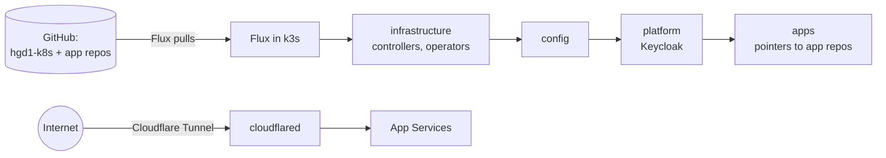

# hgd1 Kubernetes

What runs on the hgd1 k3s cluster, and how an app gets onto it. Everything
here is deployed by **Flux** from Git: this repo
([`hgd1-k8s`](https://github.com/jurrebuunk/hgd1-k8s)) holds the platform
every app uses, and each app has its own repo.

The cluster itself (the VMs, k3s, Ceph, the S3 endpoint, the monitoring
stores) is on the [cluster docs](https://jurrebuunk.github.io/nix-hgd1-cluster/);
the router, switch and VLANs on the
[network docs](https://github.com/jurrebuunk/hgd1-network/blob/main/docs/index.md).

-   :lucide-git-branch:{ .lg .middle } **GitOps**

    ---

    How Flux applies this repo and the app repos, layer by layer.

    [:octicons-arrow-right-24: GitOps](concepts/gitops.md)

-   :lucide-hammer:{ .lg .middle } **Build an app**

    ---

    What the platform gives an app, where its data goes, and the checklist.

    [:octicons-arrow-right-24: Build an app](how-to/build-an-app.md)

-   :lucide-globe:{ .lg .middle } **Public access**

    ---

    The Cloudflare Tunnel: a route and a DNS record publish an app.

    [:octicons-arrow-right-24: Public access](concepts/public-access.md)

-   :lucide-database:{ .lg .middle } **Postgres**

    ---

    One small CloudNativePG cluster per app, backed up to S3.

    [:octicons-arrow-right-24: Postgres](concepts/postgres.md)

-   :lucide-key-round:{ .lg .middle } **Keycloak**

    ---

    Logins for apps at `auth.buunk.org`.

    [:octicons-arrow-right-24: Keycloak](concepts/keycloak.md)

-   :lucide-activity:{ .lg .middle } **Monitoring**

    ---

    Pod logs and metrics, into the same stores as the hosts'.

    [:octicons-arrow-right-24: Monitoring](concepts/monitoring.md)

## At a glance

| Part | Status | Read |
| --- | --- | --- |
| Flux and sops | Done | [GitOps](concepts/gitops.md), [Manage secrets](how-to/manage-secrets.md) |
| metrics-server, local-path | Done | [GitOps](concepts/gitops.md#what-runs-here) |
| Public access (tunnel `hgd1-apps`) | Done | [Public access](concepts/public-access.md) |
| Postgres (CloudNativePG, S3 backups) | Done | [Postgres](concepts/postgres.md) |
| Monitoring of pods | Done | [Monitoring](concepts/monitoring.md) |
| Keycloak at `auth.buunk.org` | Done | [Keycloak](concepts/keycloak.md) |
| Cloudreve at `cloudreve.buunk.org` | Done | [hgd1-cloudreve](https://github.com/jurrebuunk/hgd1-cloudreve) |
| Web UI (`lab-console`) | Planned | [Web UI](concepts/web-ui.md) |
| Local ingress (LAN-only services) | Later | [PLAN.md](https://github.com/jurrebuunk/hgd1-k8s/blob/main/PLAN.md#later) |

## Apps

| App | Address | Repo |
| --- | --- | --- |
| Cloudreve | <https://cloudreve.buunk.org> | [`hgd1-cloudreve`](https://github.com/jurrebuunk/hgd1-cloudreve) |

## I want to…

| … | Go to |
| --- | --- |
| run a new app | [Build an app](how-to/build-an-app.md) |
| put an app on the internet | [Public access](concepts/public-access.md) |
| give an app a database | [Postgres](concepts/postgres.md) |
| let people log in to an app | [Keycloak](concepts/keycloak.md) |
| add or change a secret | [Manage secrets](how-to/manage-secrets.md) |
| see an app's logs or metrics | [Monitoring](concepts/monitoring.md) |
| fix something | [Troubleshooting](operate/troubleshooting.md) |
| get a kubeconfig, or change the nodes | [cluster docs: k3s](https://jurrebuunk.github.io/nix-hgd1-cluster/concepts/k3s/) |

## Conventions

- Commands run on the laptop with WARP connected and
  `KUBECONFIG=~/.kube/hgd1.yaml` (from `kubeconfig` in the `nix-hgd1-cluster`
  dev shell).
- A change is a commit: Flux applies `main` within a few minutes. Never
  `kubectl apply` something that Flux owns; it gets reverted.
- Secrets never appear in Git unencrypted, or in these docs.
- No people in Git: accounts are made in Keycloak's admin console.
