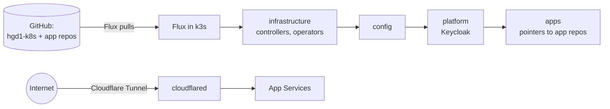

# hgd1 Kubernetes

What runs on the hgd1 k3s cluster, and how an app gets onto it. Everything
here is deployed by **Flux** from Git: this repo
([`hgd1-k8s`](https://github.com/jurrebuunk/hgd1-k8s)) holds the platform
every app uses, and each app has its own repo.

The hgd1 docs are three sites, each covering only what its repo owns:

<a class="site site--cluster" href="https://jurrebuunk.github.io/nix-hgd1-cluster/"><svg xmlns="http://www.w3.org/2000/svg" fill="none" stroke="currentColor" stroke-linecap="round" stroke-linejoin="round" stroke-width="2" viewBox="0 0 24 24"><rect width="20" height="8" x="2" y="2" rx="2" ry="2"/><rect width="20" height="8" x="2" y="14" rx="2" ry="2"/><path d="M6 6h.01M6 18h.01"/></svg>Clusternix-hgd1-clusterHosts, Ceph, S3, microVMs, the k3s nodes, monitoring, remote access, the Platform API and <code>labctl</code>.Open the docs <svg xmlns="http://www.w3.org/2000/svg" fill="none" stroke="currentColor" stroke-linecap="round" stroke-linejoin="round" stroke-width="2" viewBox="0 0 24 24"><path d="M5 12h14M12 5l7 7-7 7"/></svg></a>

<svg xmlns="http://www.w3.org/2000/svg" fill="none" stroke="currentColor" stroke-linecap="round" stroke-linejoin="round" stroke-width="2" viewBox="0 0 24 24"><circle cx="12" cy="12" r="8"/><path d="M12 2v7.5M19 5l-5.23 5.23M22 12h-7.5M19 19l-5.23-5.23M12 14.5V22M10.23 13.77 5 19M9.5 12H2M10.23 10.23 5 5"/><circle cx="12" cy="12" r="2.5"/></svg>Kuberneteshgd1-k8sWhat runs on k3s: Flux, public access, Postgres, Keycloak, and how to run an app.You're here

<a class="site site--network" href="https://jurrebuunk.github.io/hgd1-network/"><svg xmlns="http://www.w3.org/2000/svg" fill="none" stroke="currentColor" stroke-linecap="round" stroke-linejoin="round" stroke-width="2" viewBox="0 0 24 24"><rect width="6" height="6" x="16" y="16" rx="1"/><rect width="6" height="6" x="2" y="16" rx="1"/><rect width="6" height="6" x="9" y="2" rx="1"/><path d="M5 16v-3a1 1 0 0 1 1-1h12a1 1 0 0 1 1 1v3M12 12V8"/></svg>Networkhgd1-networkThe OPNsense router, the Aruba switch, the VLANs and the firewall between them.Open the docs <svg xmlns="http://www.w3.org/2000/svg" fill="none" stroke="currentColor" stroke-linecap="round" stroke-linejoin="round" stroke-width="2" viewBox="0 0 24 24"><path d="M5 12h14M12 5l7 7-7 7"/></svg></a>

-   :lucide-rocket:{ .lg .middle } **Get started**

    ---

    A kubeconfig, your first change through Flux, and a tour of the repo.

    [:octicons-arrow-right-24: Get started](get-started/index.md)

-   :lucide-lightbulb:{ .lg .middle } **Concepts**

    ---

    GitOps, public access, Postgres, Keycloak and monitoring, and why.

    [:octicons-arrow-right-24: Concepts](concepts/index.md)

-   :lucide-wrench:{ .lg .middle } **How-to guides**

    ---

    Build and publish an app, add a database, manage secrets.

    [:octicons-arrow-right-24: How-to](how-to/index.md)

-   :lucide-heart-pulse:{ .lg .middle } **Operate**

    ---

    The health check, ground rules, schedule and state outside Git.

    [:octicons-arrow-right-24: Operate](operate/index.md)

-   :lucide-book-open:{ .lg .middle } **Reference**

    ---

    Components and versions, routes and apps, credentials, the plan.

    [:octicons-arrow-right-24: Reference](reference/index.md)

-   :lucide-life-buoy:{ .lg .middle } **Troubleshooting**

    ---

    Find the fix by symptom: Flux, pods, the tunnel, Postgres, Keycloak.

    [:octicons-arrow-right-24: Troubleshooting](operate/troubleshooting.md)

## At a glance

| Part | Status | Read |
| --- | --- | --- |
| Flux and sops | Done | [GitOps](concepts/gitops.md), [Manage secrets](how-to/manage-secrets.md) |
| metrics-server, local-path | Done | [Components](reference/components.md) |
| Public access (tunnel `hgd1-apps`) | Done | [Public access](concepts/public-access.md) |
| Postgres (CloudNativePG, S3 backups) | Done | [Postgres](concepts/postgres.md) |
| Monitoring of pods | Done | [Monitoring](concepts/monitoring.md) |
| Keycloak at `auth.buunk.org` | Done | [Keycloak](concepts/keycloak.md) |
| Cloudreve at `cloudreve.buunk.org` | Done | [hgd1-cloudreve](https://github.com/jurrebuunk/hgd1-cloudreve) |
| Web UI (`lab-console`) | Planned | [Web UI](concepts/web-ui.md) |
| Internal apps over WARP (tunnel `hgd1-internal`) | Planned | [Roadmap, step 10](reference/roadmap.md#10-internal-apps-over-warp) |

## I want to…

| … | Go to |
| --- | --- |
| run a new app | [Build an app](how-to/build-an-app.md) |
| put an app on the internet | [Publish an app](how-to/publish-an-app.md) |
| see every public hostname and app | [Routes and apps](reference/routes.md) |
| give an app a database | [Add a database](how-to/add-a-database.md) |
| let people log in to an app | [Keycloak](concepts/keycloak.md) |
| add or change a secret | [Manage secrets](how-to/manage-secrets.md) |
| see an app's logs or metrics | [Monitoring](concepts/monitoring.md) |
| fix something | [Troubleshooting](operate/troubleshooting.md) |
| get a kubeconfig, or change the nodes | [cluster docs: k3s](https://jurrebuunk.github.io/nix-hgd1-cluster/concepts/k3s/) |

## Conventions

- Commands run on the laptop with WARP connected and
  `KUBECONFIG=~/.kube/hgd1.yaml` (from `kubeconfig` in the `nix-hgd1-cluster`
  dev shell).
- A change is a commit: Flux applies `main` within a few minutes. Never
  `kubectl apply` something that Flux owns; it gets reverted.
- Secrets never appear in Git unencrypted, or in these docs.
- No people in Git: accounts are made in Keycloak's admin console.
